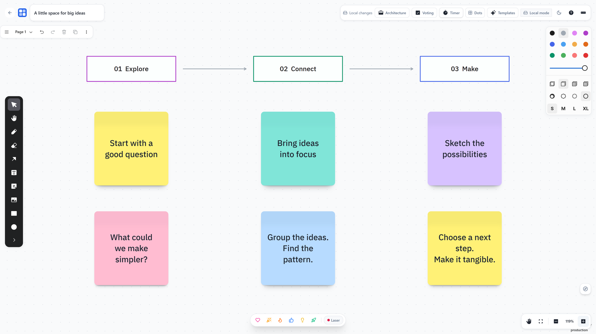
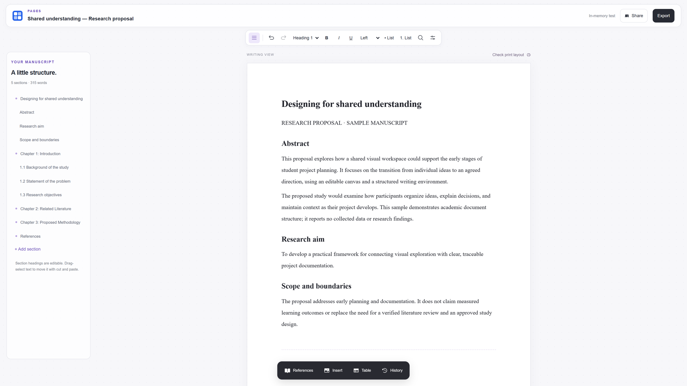
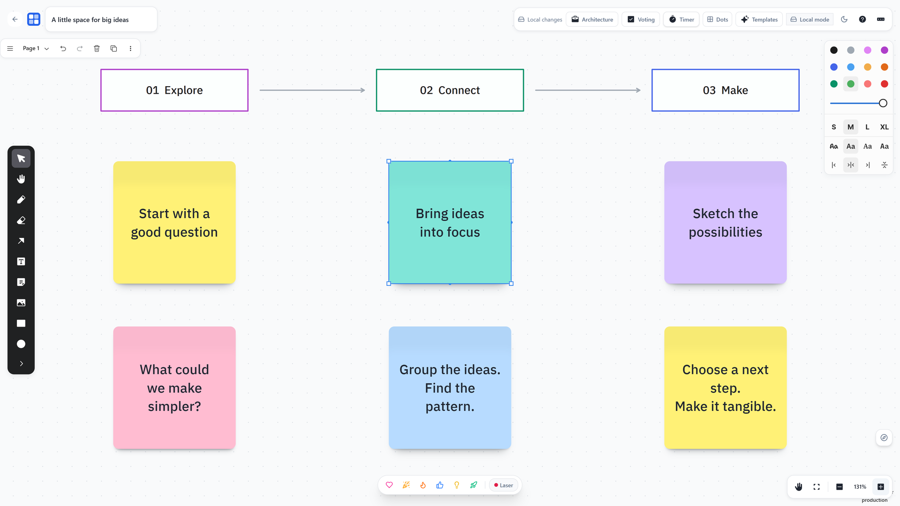
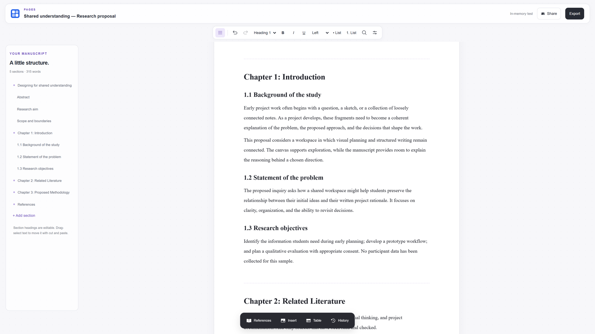

# CollabCanvas

**A creative workspace for visual ideas and structured documents.**

CollabCanvas brings together **Whiteboard**, an infinite canvas for sketches,
sticky notes, and shared visual planning, and **Pages**, a rich-text workspace for
research proposals, thesis manuscripts, and technical documents. Each editor has
its own document model: tldraw powers Whiteboard; Tiptap and Yjs power Pages.
Exported Whiteboard images can be inserted into Pages.

[Live application](https://collab-canvas-web-beta.vercel.app/) ·
[Portfolio case study](https://janmark-suelto.vercel.app/projects/collabcanvas)

**Status: working prototype.** Local editing and export have automated coverage
and recorded browser validation. Cloud deployment and multi-user verification
have separate requirements; see [Feature status](#feature-status).

## Application preview

### Whiteboard



Visual planning with drawing tools and contextual style controls. This capture
shows local mode, not evidence of a live multi-user session.

### Pages



A real editor capture using a sample research proposal. The sample contains no
collected research findings; its in-memory session is separate from cloud saving.

## Features

### Whiteboard

- Infinite canvas with sticky notes, freehand drawing, text, shapes, connectors,
  and image insertion.
- Floating tools, contextual styles, zoom controls, and editable templates.
- Board creation, search, sorting, duplication, recent access, and deletion.
- Cloud-mode document synchronization and cursor presence through authenticated
  WebSockets, with owner/editor/viewer roles.
- Share links, member invitations, manual snapshots, and PNG/PDF export.

Cloud collaboration requires configured Supabase and Worker services. Local
boards and the temporary landing-page playground do not synchronize with other users.

### Pages

- Six editable starting points: thesis, capstone, research proposal, paper,
  technical documentation, and blank academic document.
- Rich-text editing with headings, lists, tables, links, images, undo/redo, and
  find/replace; a collapsible outline supports section navigation.
- Paper size, orientation, margins, typography, alignment, and spacing controls.
- Browser drafts backed by IndexedDB, named checkpoints, and `.pages.json`
  recovery backups. Cloud creation is explicit and does not silently fall back
  to a browser draft.
- Author-entered references with APA 7, IEEE, and MLA formatting, citations,
  bibliography, captions, and cross-references.
- On-demand print layout with contents, section breaks, headers/footers,
  preliminary Roman numbering, and Arabic main numbering.
- DOCX export and import; PDF output through the browser's print dialog.

Writing is continuous, **not live paginated WYSIWYG editing**. Print layout is a
separate preview. Templates and citation tools do not certify compliance with an
institution's thesis rules. DOCX import is not lossless; exported Word contents
fields need updating in Word. See [Pages implementation notes](docs/pages-implementation.md).

## Feature status

“Tested” below describes existing automated coverage and recorded validation in
the repository, not a guarantee that every deployed environment has passed.

| Area                                                            | Status                                        | Evidence or remaining work                                                                                                                         |
| --------------------------------------------------------------- | --------------------------------------------- | -------------------------------------------------------------------------------------------------------------------------------------------------- |
| Local Whiteboard state and editor integration                   | Implemented and tested                        | Persistence, canvas, dashboard, and export unit tests; landing-preview browser scenarios.                                                          |
| Pages templates, editing, recovery, and DOCX generation         | Implemented and tested                        | Template/format/role tests, Yjs convergence tests, recovery validation, DOCX round-trip text test.                                                 |
| Pages print layout and temporary previews                       | Implemented and tested                        | Existing browser scenarios and recorded PDF/DOCX inspection in the Pages notes; verify complex manuscripts individually.                           |
| Whiteboard cloud synchronization, sharing, and protected assets | Implemented; deployment verification required | Worker authorization tests and gated collaboration scenarios exist; confirm with separate accounts against the intended backend.                   |
| Pages cloud saving, roles, comments, and concurrent editing     | Implemented; integration verification pending | Migration and three-second Yjs update polling exist. Recorded validation was blocked by hosted permissions and an unavailable local Docker daemon. |
| Live Pages pagination, presence cursors, and automatic history  | Not implemented                               | Print preview and explicit checkpoints are available; these are separate future improvements.                                                      |

Pages uses three-second database polling, not Whiteboard's WebSocket transport.
Unit-level Yjs convergence does not validate database RLS or real cross-account
access. Follow the [testing matrix](docs/testing.md) before claiming deployment readiness.

## Technology stack

Versions below are declared in the workspace package manifests.

| Layer                   | Technologies                                                                                                                      |
| ----------------------- | --------------------------------------------------------------------------------------------------------------------------------- |
| Frontend                | React 19.2.8, TypeScript 5.8.3, Vite 7.3.6, React Router 8.3.0, Tailwind CSS 4.3.3, Phosphor and Lucide icons                     |
| Backend                 | Cloudflare Workers, Durable Objects, Wrangler 4.116.0, Zod validation                                                             |
| Database and assets     | Supabase Auth and PostgreSQL with Row Level Security; Durable Object SQLite; Cloudflare R2; IndexedDB for local Pages drafts      |
| Canvas                  | tldraw and `@tldraw/sync` 5.2.5                                                                                                   |
| Documents               | Tiptap 3.32.0, Yjs 13.6.33, `y-indexeddb`, Paged.js, Citation.js, `docx`, Mammoth, DOMPurify; `pdf-lib` for Whiteboard PDF export |
| Communication           | Authenticated WebSockets for Whiteboard; Supabase-backed Yjs update polling for Pages                                             |
| Development and testing | npm workspaces, Vitest 3.2.7, Testing Library, Playwright 1.62.1, ESLint, Prettier, GitHub Actions                                |

Whiteboard metadata and permissions live in Supabase; each cloud board's document
state lives in a SQLite-backed Durable Object. R2 holds protected assets and
snapshots. Pages uses its own manuscript, membership, update, comment, and revision
tables. See [architecture](docs/architecture.md) and [security](docs/security.md).

## Getting started

### Prerequisites

- Node.js 24 or newer and npm 11+ (the repository's documented baseline).
- Docker Desktop running for a local Supabase database.
- The Supabase CLI is included as a development dependency; use `npx supabase`.
- Cloudflare credentials are needed for remote Worker/R2 operations. Wrangler is
  included in the Worker workspace.

### Install and try the public previews

```bash
git clone https://github.com/RaizelHub/collab-canvas.git
cd collab-canvas
npm ci
npm run dev:web
```

Open [http://127.0.0.1:5173](http://127.0.0.1:5173) and choose Whiteboard or Pages in
the landing playground. These temporary previews do not require production
accounts. Normal dashboard and Pages-library routes require Supabase setup and
authentication. Vite may choose another port if 5173 is occupied.

### Configure the full local stack

Copy the supplied examples (PowerShell):

```powershell
Copy-Item apps/web/.env.example apps/web/.env.local
Copy-Item apps/sync-worker/.dev.vars.example apps/sync-worker/.dev.vars
```

On macOS/Linux, use `cp` in place of `Copy-Item`. Keep existing local environment
files if they are already configured.

| File                         | Variables                                                                                                                                       |
| ---------------------------- | ----------------------------------------------------------------------------------------------------------------------------------------------- |
| `apps/web/.env.local`        | `VITE_APP_NAME`, `VITE_APP_URL`, `VITE_SUPABASE_URL`, `VITE_SUPABASE_ANON_KEY`, `VITE_SYNC_SERVER_URL`                                          |
| `apps/sync-worker/.dev.vars` | `SUPABASE_URL`, `SUPABASE_ANON_KEY`, `SUPABASE_SERVICE_ROLE_KEY`, `ALLOWED_ORIGINS`, `ASSET_SIGNING_SECRET`; optional `PORTFOLIO_ADMIN_USER_ID` |

Use values from your own local Supabase instance. Keep the service-role key and
signing secret exclusively on the Worker side, never in a `VITE_` variable. Generate
a random signing secret of at least 32 characters. Neither example contains live
credentials; `.env.local` and `.dev.vars` are ignored by Git.

From the repository root, initialize a **disposable local database**:

```bash
npx supabase start
npx supabase db reset
npx supabase status
```

`db reset` destroys and recreates local database contents; do not use it for data
you need to retain. The migrations include Whiteboard tables and
`20261024000100_pages.sql`. The default API URL is `http://127.0.0.1:54321`.
Populate both environment files from the local status output without committing
the keys.

Set the frontend URL to `http://127.0.0.1:5173`, the sync URL to
`http://127.0.0.1:8787`, and include the frontend origin in `ALLOWED_ORIGINS`.
Configure Supabase's site/redirect URLs for that same hostname, including
`/reset-password`; the checked-in Auth configuration uses `localhost`, so align it
with `127.0.0.1` if using the Vite default. Restart after environment changes.

```bash
npm run dev
```

This runs Vite and Wrangler together. For separate terminals, use
`npm run dev:web` and `npm run dev:worker`.

The checked-in Wrangler configuration includes a `remote: true` R2 binding named
`y`, in addition to `BOARD_ASSETS`. Review that binding before running the Worker
against accounts or buckets: do not assume every resource is locally emulated.
For hosted setup, migration review, R2 provisioning, Worker secrets, and SPA
deployment, follow [deployment instructions](docs/deployment.md).

## Project structure

```text
apps/
  web/
    src/features/whiteboard/  # tldraw canvas and controls
    src/features/pages/       # Tiptap/Yjs editor, persistence, citations, export
    src/features/auth/        # Supabase authentication
    src/routes/               # Application routing
    e2e/                      # Playwright scenarios and local studio fixture
  sync-worker/
    src/                      # Auth, rooms, assets, sharing, maintenance
    test/                     # Worker unit tests
    wrangler.jsonc            # Bindings and Durable Object migrations
packages/shared/              # Shared contracts and validation
supabase/                     # Database configuration, migrations, seed
docs/                         # Architecture, security, testing, screenshots
.github/workflows/            # CI and database activity checks
```

## Screenshots

The [Whiteboard overview](docs/screenshots/whiteboard-overview.webp) and
[Pages editor](docs/screenshots/pages-editor.webp) appear above. The additional
captures below show actual tools and an academic section, using sample content.

### Whiteboard tools



### Academic document view



This is a research-proposal sample with academic headings, not an automatically
generated or institution-approved thesis. The existing optimized WebP captures
were reused without recreating the interface.

## Development

Run these scripts from the repository root:

| Command                | Purpose                                                                |
| ---------------------- | ---------------------------------------------------------------------- |
| `npm run dev`          | Run frontend and Worker together                                       |
| `npm run typecheck`    | Check workspace TypeScript                                             |
| `npm run lint`         | Run workspace ESLint checks                                            |
| `npm run test`         | Run workspace Vitest suites                                            |
| `npm run test:watch`   | Watch frontend unit tests                                              |
| `npm run format:check` | Check formatting with Prettier                                         |
| `npm run build`        | Build frontend and run the Worker deployment dry run; does not publish |
| `npm run test:e2e`     | Run Playwright against an already running application                  |

Install the configured browser once with
`npm exec --workspace=@collab-canvas/web -- playwright install chromium`.
Playwright defaults to `http://127.0.0.1:5173`; its configuration does not start a
server. Start `npm run dev:web` before local preview/studio scenarios. The studio
fixture is a development-server route, not a deployed application route.

For live Whiteboard collaboration scenarios, also supply `E2E_BASE_URL`,
`E2E_USER_A_EMAIL`, `E2E_USER_A_PASSWORD`, `E2E_USER_B_EMAIL`, and
`E2E_USER_B_PASSWORD` through your shell or CI secrets. Use dedicated test accounts.
Without them the gated collaboration scenarios are skipped. Local Pages/landing
scenarios do not establish that cloud RLS and transport work.

The [testing guide](docs/testing.md) covers two-browser checks, revocation,
reconnection, exports, and database policies. [Pages notes](docs/pages-implementation.md)
record export fidelity limits and previous browser validation. Existing validation
records are historical evidence; rerun the appropriate checks for your environment.

## Roadmap

- Apply and integration-test the Pages migration in an authorized environment,
  including owner/editor/commenter/viewer access, revocation, comments, and recovery.
- Compact long Pages update logs with server-side snapshots before sustained
  large-document deployments.
- Extend cross-browser print/export checks for tall table rows, large images,
  complex footnotes, and Word pagination differences.
- Add dashboard thumbnail generation and automatic snapshot scheduling; current
  snapshots/checkpoints are explicit actions.
- Add server-side invitation email delivery; current invitations provide a link
  to copy, not automatic email delivery.

Pages presence cursors, live editable pagination, and suggested edits are not
implemented. Public board links still require an authenticated account; the
anonymous portfolio room is a separate feature. Database keep-alive jobs are
best-effort activity checks, not an uptime guarantee or a way to resume a paused
project. See [troubleshooting](docs/troubleshooting.md).

## Author

**Janmark Suelto**

- GitHub: [RaizelHub](https://github.com/RaizelHub)
- Portfolio: [janmark-suelto.vercel.app](https://janmark-suelto.vercel.app/)
